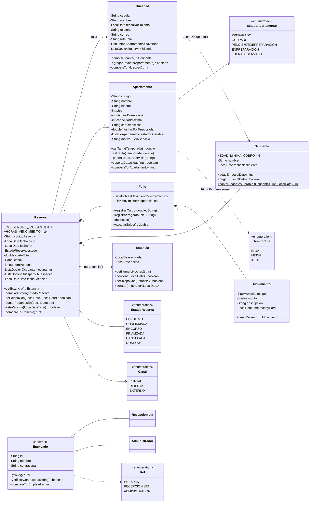
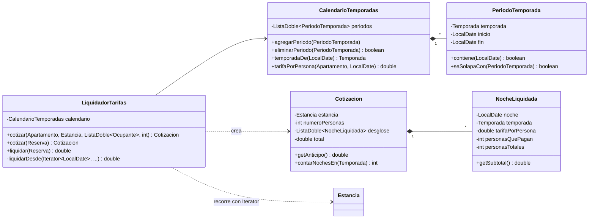
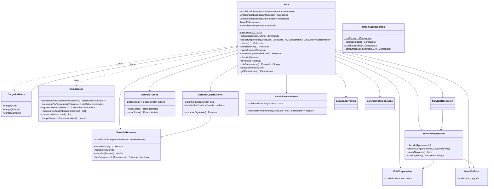

# Diagrama de clases – SGA Aparta-Suites UQ

Vista del modelo de dominio, la fachada y los servicios. Las estructuras propias tienen su
propio diagrama en [diagrama-estructuras.md](diagrama-estructuras.md).

## Dominio

## Temporadas, tarifas y liquidación

`liquidarDesde` es **recursivo**: caso base, el iterador no tiene más noches (vale 0); caso
recursivo, el valor de la noche siguiente más la liquidación del resto de la estancia.

## Fachada, servicios y carga de datos

La interfaz gráfica (paquete `view`) solo habla con `SGA`: `LoginView` → `VentanaPrincipal`, que
abre `CotizacionView`, `TemporadasTarifasView`, `EstadisticasView`, `CargaDatosView` y las
pantallas del equipo (tablero, mapa, preparación, panel de usuario y folio).
