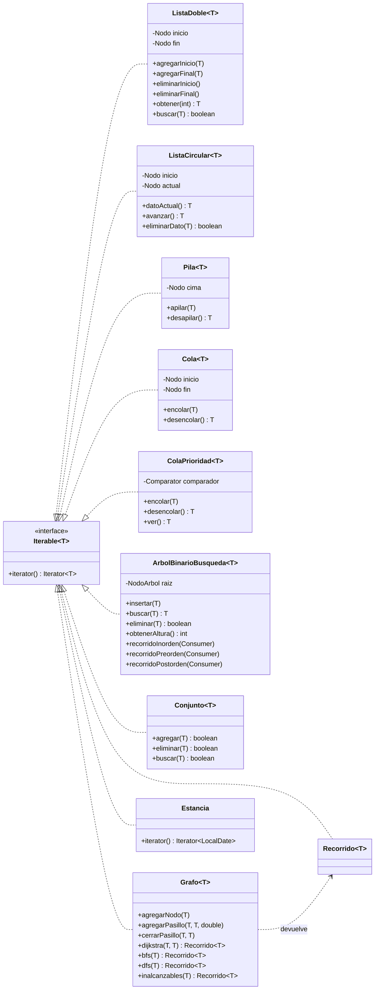

# Diagrama de estructuras propias

Todas las estructuras son **genéricas**, implementan `Iterable<T>` con su propio `Iterator<T>` y
están en el paquete `model.Estructuras`. El núcleo del sistema no usa colecciones de `java.util`.

## Dónde se usa cada estructura

| Estructura | Uso en el SGA |
| --- | --- |
| `Grafo<String>` | Mapa del edificio (`MapaEdificio`): nodos = apartamentos, recepción, escaleras, zonas de aseo; aristas = pasillos en metros. Ruta de preparación con Dijkstra; BFS/DFS para conectividad e inalcanzables. |
| `ColaPrioridad<T>` | Cola de preparación (prioridad 1: entrada hoy por hora de llegada; 2: el resto) y reservas Pendientes por hora de vencimiento. |
| `Cola<T>` | Solicitudes del canal externo, procesadas en orden de llegada (FIFO). |
| `Pila<T>` | Deshacer la última operación del folio; botón "Atrás" de la ventana principal. |
| `ListaDoble<T>` | Ocupantes de una reserva, desglose de noches liquidadas, periodos de temporada (ordenados), historial del huésped, resultados de búsqueda y reportes. |
| `ListaCircular<T>` | Rotación de turnos de los recepcionistas. |
| `ArbolBinarioBusqueda<T>` | Catálogos de la fachada: apartamentos por código, huéspedes por documento, empleados por id; reservas por fecha de entrada en `ServicioReservas`. |
| `Conjunto<T>` | Apartamentos favoritos de cada huésped (sin repetidos). |
| `Estancia` (Iterable) | `for (LocalDate noche : estancia)` recorre las noches a cobrar; base de la liquidación y de las estadísticas. |
